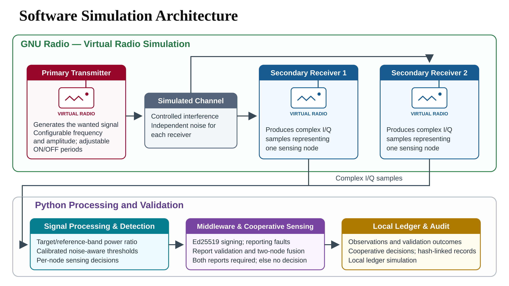

# Senior Design: Spectrum Sensing

**End-to-End Hardware Validation of a Jamming-Resilient Cooperative Spectrum Sensing Framework**

Current phase: **end-to-end software validation** using GNU Radio and Python. The project topic remains unchanged; physical RF validation and live blockchain integration are planned for the next semester.

## Project status — November 13, 2026

| Workstream | Current evidence | Remaining work |
| --- | --- | --- |
| GNU Radio simulation | Preserved energy-detection baseline; two virtual receivers and native software acquisitions | Independent reproduction from a fresh checkout and broader channel models |
| Noise-aware detection | Calibrated reference-band detector; frozen 8,000-sample thresholds evaluated with held-out seeds | Wider noise/interference conditions and measured RF calibration |
| Signed cooperative reports | Ed25519 validation, report-fault experiments and two-node OR integration | Measured network timing and physical multi-node operation |
| Combined reliability | 50 completed evaluations: two noise conditions × five reporting profiles × five seeds | Improve availability and evaluate alternatives without retuning on test data |
| Local audit ledger | Local hash-linked records and simulated batch receipts | Smart contracts, deployment and verified blockchain transactions |
| RF hardware | Existing transmitter files preserved | Receiver calibration and repeatable RF trials |
| Automated checks | 56 behavioral/protocol tests passed in the documentation authoring environment | Tests do not substitute for GNU Radio, Windows or RF execution |

## Verified software results

[Published run records and full metric definitions](experiments/combined_reliability_2026_11/README.md)

| High-noise result | Clean reports | Combined reporting faults |
| --- | ---: | ---: |
| Detected occupied frames | 983 | 361 |
| Missed occupied frames | 17 | 7 |
| Occupied frames without a decision | 0 | 632 |
| Detection among occupied frames with a decision | 98.3% | 98.1% |
| Detected fraction of all occupied frames | 98.3% | 36.1% |
| Overall decision availability | 100% | 39.8% |

Each column contains 1,000 occupied and 1,000 unoccupied frames, pooled over five seeds. High noise scales I/Q standard deviation by 1.2. Clean false-alarm rate is 3.6%. High conditional detection does not mean reliable service when many frames receive no decision. These are software results with simulated transport, not RF performance or measured network latency.

## Architecture



GNU Radio models the signal/channel and two sensing nodes. Python handles noise-aware detection, signed reports, validation, cooperative fusion and local audit records. Both usable reports are required for OR fusion; missing or rejected reports produce **no decision**, not signal absent. [Architecture and limitations](documentation/ARCHITECTURE.md).

## Run the experiments

Clone this repository and use the Python environment that contains GNU Radio. On the team's Windows setup, ordinary PowerShell `python` may point outside Radioconda.

```powershell
& "$env:USERPROFILE\radioconda\python.exe" -c "from gnuradio import gr; print(gr.version())"
& "$env:USERPROFILE\radioconda\python.exe" -m pip install -r cooperative_sensing/requirements-trust.txt
& "$env:USERPROFILE\radioconda\python.exe" -u cooperative_sensing/run_combined_reliability.py
```

Alternatively run `simulation/RUN_COMBINED_RELIABILITY_WINDOWS.bat`. Use `--cycles 5` only for a labeled smoke run; the published matrix uses 50 cycles.

- [Simulation baseline and setup](simulation/README.md)
- [Full simulation](simulation/FULL_SIMULATION.md)
- [Signed detector integration](cooperative_sensing/SIGNED_DETECTOR.md)
- [Combined reliability method](cooperative_sensing/COMBINED_RELIABILITY.md)
- [Separate five-node trust pilot](cooperative_sensing/TRUST_STUDY.md)
- [Tests](tests/README.md)

## Repository map

| Folder | Purpose |
| --- | --- |
| `transmitter/` | Preserved GNU Radio hardware transmitter |
| `receiver/` | Planned physical RF acquisition |
| `simulation/` | GNU Radio models, calibration and experiment runners |
| `detection_algorithms/` | Detection and evaluation workstream |
| `cooperative_sensing/` | Signed reports, fusion and reliability experiments |
| `blockchain/` | Future chain integration workstream |
| `experiments/` | Experiment plans and reviewed evidence |
| `documentation/` | Architecture, setup, presentation assets and animation brief |
| `tests/` | Behavioral, protocol and runner checks |

## Presentation and research materials

- [Progress deck, diagrams and asset notes](documentation/presentations/README.md)
- [2D animation brief for Claude](documentation/ANIMATION_BRIEF.md)
- [Reference list](documentation/REFERENCES.md)
- [Roadmap through April](ROADMAP.md)

## Reproducible engineering

Record the source commit, environment, configuration, sample origin, seeds, detector policy and metric denominators. Keep full acquisition/audit folders outside Git when large; retain their hashes and evidence references. Never commit private keys, credentials or wallet secrets. A signature or ledger entry cannot prove a sensed observation is true. Energy detection alone does not identify malicious jamming.

Changes use feature branches and pull requests. See [CONTRIBUTING.md](CONTRIBUTING.md) and the [validation plan](documentation/VALIDATION.md).

## License

The existing generated transmitter Python file carries an SPDX GPL-3.0 notice, which is preserved. No repository-wide license has been selected; contributors should agree on licensing before redistribution of new project material.
