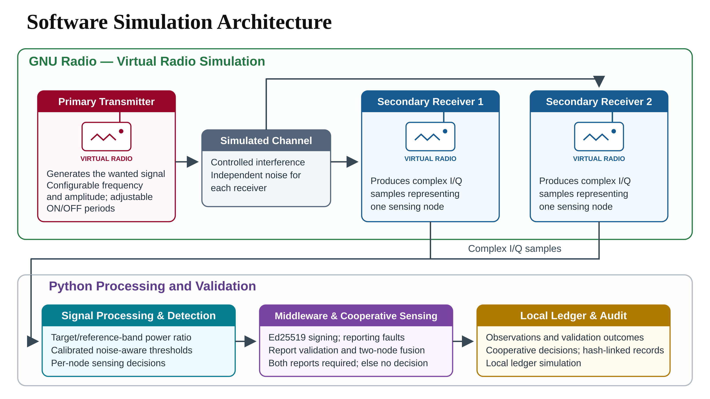

# Software simulation architecture

## Current implementation

| Boundary | Technology and role |
| --- | --- |
| Virtual transmitter and channel → two virtual receivers | GNU Radio generates wanted-signal ON/OFF scenarios, controlled interference and independent receiver noise; outputs complex I/Q samples. |
| Samples → local decisions | Python/NumPy computes target/reference-band power over 8,000 samples at 2 MS/s (4 ms of simulated observation) and applies frozen calibrated thresholds. |
| Decisions → authenticated reports | Python uses Ed25519 signatures and node/frame identifiers; reporting faults are injected during offline replay. |
| Reports → cooperative decision | Signature, identity, sequence/replay, freshness and quality checks precede two-node OR fusion. Both reports must be usable; otherwise output no decision. |
| Validation and decisions → audit | Local hash-linked records and simulated batch commitments preserve an audit trail. This is a local ledger simulation, not a deployed blockchain. |

The five-node synthetic trust pilot is a separate experiment from the two-node GNU Radio integration. Valid signatures establish origin/integrity, not measurement truth; signed fabrication and majority collusion remain limitations. Timing anomalies do not prove attacks.

## Next hardware phase

Replace virtual signal acquisition with calibrated SDR captures, measure reporting timing, evaluate cooperative RF behavior and integrate a development blockchain with verified transaction receipts. Keep the existing transmitter files as the hardware baseline.

[Executed evidence](../experiments/combined_reliability_2026_11/README.md) · [Signed-report policy](../cooperative_sensing/SIGNED_DETECTOR.md) · [Roadmap](../ROADMAP.md)
